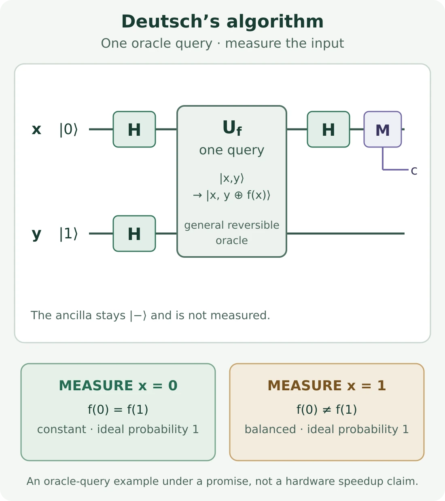

In [Part 1](/posts/classical-vs-quantum-logic-gates/), a quantum gate transformed a state instead of evaluating a Boolean value. [Part 2](/posts/qubits-superposition-phase-bloch-sphere/) explained the amplitudes and relative phase inside a single-qubit state. [Part 3](/posts/entanglement-and-bell-states/) expanded that picture to joint states that cannot be described one qubit at a time.

Those ideas lead to a practical question: if measuring a quantum computer produces classical results, how can quantum circuits compute anything useful? The answer is not that a device tries every answer and prints them all. A circuit transforms probability amplitudes so that, when paths combine, some outcomes reinforce and others cancel. Measurement samples the resulting distribution; the algorithm’s structure is what makes that sample informative.

## From quantum states to quantum programs

A quantum program is often represented as a **quantum circuit**: wires carry qubits, gates apply operations, and measurements produce classical bits. The circuit is a finite sequence of state transformations. A wire is not a stream of readable Boolean values, and the diagram is not an ordinary control-flow graph with an `if` branch at every gate. It records which operation acts on which qubits and in what order.

In the ideal circuit model, gates before measurement apply unitary transformations. Their evolution is deterministic: the same input state and same gate sequence produce the same final quantum state. Probabilistic outcomes enter when that state is measured. Real devices add noise, and practical algorithms may use classical feedback, but neither fact changes the basic distinction between transforming a state and observing a classical result.

That distinction also explains why circuit order matters. Read a circuit from left to right as time. The rightmost operation in a written product acts first: `H Z |0⟩` means apply Z to `|0⟩`, then apply H. We will write both the circuit order and the corresponding state changes explicitly in the examples below.

A gate drawn on one wire acts on that qubit while the other wires continue as part of the joint state. A two-qubit gate, such as CNOT, acts on a pair together. Operations on separate wires are not automatically independent if the qubits are entangled; the complete state is still transformed as a whole. In a circuit drawing, a box labeled `U_f` can stand for an operation whose internal implementation is intentionally hidden. This is the **oracle model** used in query-complexity examples: count how many times the problem-dependent operation is called, while treating its implementation cost separately.

Measurement symbols near the end of a circuit indicate which qubits are converted to classical outcomes. Measuring only one wire does not produce a dump of the other wires’ amplitudes. If an algorithm samples outcomes, one circuit execution is one shot. Repeating the same preparation and circuit estimates the distribution, just as Part 2 used repeated measurements to estimate probabilities. The circuit and its classical post-processing are therefore both parts of the program: the former shapes a quantum state; the latter interprets the bits returned by measurement.

## Amplitudes are transformed before probabilities are calculated

For a single qubit, write the state as `|ψ⟩ = α|0⟩ + β|1⟩`. A computational-basis measurement returns `0` with probability `|α|²` and `1` with probability `|β|²`. The amplitudes may be complex; probabilities are nonnegative real numbers. Squaring a magnitude happens at measurement, after the circuit has finished combining amplitudes.

This order is the key. If two different components of a state can lead to the same measured outcome, the circuit adds their **amplitudes** first. Only then do we take the squared magnitude to get the probability. For a simple real-valued illustration, contributions `1/2 + 1/2 = 1` produce a larger amplitude, while `1/2 − 1/2 = 0` remove an outcome entirely. Those are not arbitrary arithmetic operations: a gate’s unitary transformation determines the contribution and its sign or phase for each output.

When contributions line up, we call the result constructive interference. When their relative phases make them cancel, we call it destructive interference. Probabilities themselves do not cancel. The cancellation occurs among amplitudes before the Born rule turns the final amplitudes into measurement probabilities. Part 2 introduced this idea for one qubit; a circuit makes it a reusable computational technique.

## Hadamard twice: a compact interference experiment

The Hadamard gate acts on the computational-basis states as:

```text
H|0⟩ = (|0⟩ + |1⟩) / √2
H|1⟩ = (|0⟩ − |1⟩) / √2
```

Start in `|0⟩` and apply H. The result is `|+⟩ = (|0⟩ + |1⟩)/√2`. If we measured now in the computational basis, either bit would occur with probability one half. But suppose we do not measure and apply H again:

```text
H(H|0⟩)
= 1/2 [(|0⟩ + |1⟩) + (|0⟩ − |1⟩)]
= |0⟩
```

For the output `|0⟩`, each route contributes `1/2`, so the amplitudes reinforce. For `|1⟩`, one route contributes `1/2` and the other `−1/2`, so they cancel. The final state is exactly `|0⟩`; an ideal final computational-basis measurement returns zero with probability one. In operator notation, `H² = I`: applying H twice is the identity operation.

This is not equivalent to measuring after the first H and then running another H. If an intermediate measurement yields zero, the next H prepares `|+⟩`; if it yields one, H prepares `|−⟩`. Either way, a final computational-basis measurement is 50/50. The intermediate measurement removed the coherence between the two components that the second H needed to interfere. Measurement is an operation in the experiment, not a log statement that can be inserted without consequence.

## Relative phase changes what the next gate can reveal

Pauli-Z leaves `|0⟩` unchanged and changes the sign of `|1⟩`: `Z|0⟩ = |0⟩` and `Z|1⟩ = −|1⟩`. Applying Z to `|+⟩` therefore gives `|−⟩ = (|0⟩ − |1⟩)/√2`. The states `|+⟩` and `|−⟩` still have the same 50/50 probabilities if measured immediately in the computational basis. Z has changed the state’s relative phase, not those immediate probabilities.

Now apply H. We know from Part 2 that `H|+⟩ = |0⟩` and `H|−⟩ = |1⟩`. The complete sequence, read left to right, is:

```text
|0⟩  --H-->  |+⟩  --Z-->  |−⟩  --H-->  |1⟩
```

Thus `HZH|0⟩ = |1⟩`; in fact, `HZH = X`. Compare it with `H` followed by `H`, which returns `|0⟩`. The inserted Z does not act like a probabilistic choice. It deterministically changes the phase relationship, and the final H converts that phase difference into a different measured bit. This is why circuit design often includes operations whose effect is invisible in the current measurement basis but visible after later gates.

The phase here is relative: one component changes sign while another does not. Multiplying the entire state by `−1` would be a global phase and would not change observable measurement statistics. That distinction will matter in Deutsch’s algorithm, where a phase common to the whole state can be factored out without affecting the answer.

## Interference in multi-qubit circuits

An `n`-qubit pure state has up to `2ⁿ` computational-basis amplitudes. A gate can transform the joint state, and several different computational paths through a circuit can contribute to one final bit string. Their amplitudes combine, including their phases; measurement then samples a bit string according to the squared magnitude of its final amplitude.

Superposition, interference, and entanglement are related but distinct. Superposition describes a state written as a combination of basis states. Interference describes how amplitudes for an outcome combine after transformations. Entanglement describes a joint state that cannot be factored into independent pure states for its parts. Interference can occur with one qubit and no entanglement, as H–H already showed. Multi-qubit algorithms may use entanglement, but simply adding qubits or producing an entangled state does not by itself solve a problem faster.

For a pair of qubits, the final measurement has four possible bit strings: `00`, `01`, `10`, and `11`. Each one has a joint amplitude. If different parts of the circuit lead to `10`, for example, those contributions combine into the amplitude for `10`; its probability is calculated only after that sum. A gate acting on the pair can redistribute amplitude across all four outcomes at once. With more wires the same rule applies across `2ⁿ` basis strings. A circuit need not make every answer likely. It must arrange the transformation so that outcomes carrying the desired information have a useful probability when measured.

This also shows why “parallel evaluation” is an incomplete description. A reversible oracle can act on a superposition of inputs, but its outputs remain amplitudes in one joint state. Measurement yields one sample, not a list of every input-output pair. To extract a property from the oracle, an algorithm has to make the relevant phase relationships affect an observable outcome. Deutsch’s circuit gives a concrete, two-qubit case where that process can be checked line by line.

At a high level, many algorithm explanations can be organized as: prepare a state, apply gates that encode or query information, arrange interference, measure, and interpret the classical result. This is a teaching model, not a universal template. Algorithms differ in their promise, input encoding, measurement strategy, error handling, and resource requirements. An arbitrary gate sequence has no reason to produce a useful answer; the transformations must be designed around a specific problem.

## Deutsch’s algorithm: using a phase to answer a query problem

Deutsch’s algorithm is a small example where every step fits on two qubits. It solves a deliberately constrained oracle problem, not a practical workload. The input is a Boolean function `f: {0,1} → {0,1}` with a promise that it is either **constant**, where `f(0) = f(1)`, or **balanced**, where `f(0) ≠ f(1)`. The task is to decide which case applies.

In a black-box query model, a deterministic classical algorithm needs two queries: learning one function value alone does not say whether the other is equal or different. Deutsch’s quantum circuit determines the answer with one query to a reversible oracle. This is a precise query-complexity separation for the stated problem. It does not imply that the quantum circuit is faster in wall-clock time on present hardware, or that arbitrary functions can be learned from one query.

The oracle is a reversible operation defined by `U_f|x,y⟩ = |x, y XOR f(x)⟩`. It leaves the input `x` intact and XORs the function output into a target bit `y`. A general `f` is not implemented by pretending one fixed CNOT represents every function. The oracle is a box in the algorithmic model; a particular reversible circuit for that box depends on the function being queried.

The initial state is `|0⟩|1⟩`. Apply H to both qubits:

```text
|0⟩|1⟩  →  |+⟩|−⟩
```

The first qubit holds the input in a superposition. The second, called the ancilla, is prepared in `|−⟩` so that XORing `f(x)` into it turns the function value into a phase on the corresponding input component.

<figure class="article-figure">



<figcaption>Deutsch’s circuit queries the promised function once. The final measurement of the input wire is zero for a constant function and one for a balanced function; the ancilla is not measured.</figcaption>

</figure>

### The oracle turns a function value into phase

The reason the ancilla is `|−⟩` is the identity `X|−⟩ = −|−⟩`. If `f(x) = 0`, the oracle leaves the ancilla alone. If `f(x) = 1`, it applies X, which returns the same `|−⟩` state multiplied by `−1`. For a basis input this gives:

```text
U_f(|x⟩|−⟩) = (−1)^f(x)|x⟩|−⟩
```

By linearity, after the oracle the combined state is:

```text
[(-1)^f(0)|0⟩ + (-1)^f(1)|1⟩] / √2  ⊗  |−⟩
```

The oracle has encoded the two function values as a relative phase between the input alternatives. The ancilla remains `|−⟩` and can be set aside. This effect is called **phase kickback**. It is not a message sent from the ancilla to the input; it is the result of applying a reversible two-register operation to a state whose target register is an eigenstate of X.

If `f` is constant, both input components receive the same sign. The common factor is only a global phase: either `+1` or `−1` multiplies the whole input state and has no observable effect. If `f` is balanced, the two components receive opposite signs, which is a relative phase. That difference is what the final gate can detect.

### The final Hadamard makes the answer measurable

Apply H to the input qubit. If `f` is constant, the input is `|+⟩` up to global phase, and H maps it to `|0⟩`. If `f` is balanced, the input is `|−⟩` up to global phase, and H maps it to `|1⟩`. The final joint state is therefore `|0⟩|−⟩` or `|1⟩|−⟩`, up to an unobservable global sign.

In the ideal model, measuring the input returns zero with certainty for a constant function and one with certainty for a balanced function. The circuit does not read both values and then print them. It creates a relative phase from the oracle’s behavior and uses interference in the final Hadamard to make the promised property visible in one measured bit. IBM Quantum Learning works through this same state evolution and notes the one-query versus two-query comparison; the historical result is best understood within this oracle model.

## What a quantum speedup does—and does not—mean

Query count is one resource measure, not a synonym for end-to-end runtime. A real implementation also pays for preparing inputs, building and compiling gates, moving qubits through available connectivity, controlling the device, repeating measurements, correcting or mitigating errors, and processing results classically. Noise can turn an ideal deterministic output into an imperfect distribution. A smaller query count is valuable when the oracle is costly and the rest of the implementation fits the model, but it is not by itself a hardware benchmark.

The oracle assumption deserves particular attention. In the abstract problem, evaluating `U_f` counts as one query regardless of what computing `f` actually entails. If an application must build that operation from a large classical description, the gate count, circuit depth, and data-loading cost belong in the comparison too. A one-query result is meaningful because it isolates a model of access to information, not because every physical oracle is a free, one-gate black box. Good comparisons state what is counted and what is assumed to be available.

Deutsch’s problem is intentionally tiny: it establishes how quantum interference can answer a question under a promise with fewer oracle calls. It does not demonstrate practical quantum advantage, nor should it be confused with the generalized Deutsch–Jozsa algorithm. More broadly, useful speedup claims compare complete algorithms under explicit assumptions, including input size, precision, gate cost, error correction, and the best relevant classical method. Quantum algorithms are specialized approaches, not a general replacement for conventional programs.

## Simulating and testing quantum circuits

For small circuits, a classical simulator can apply the same gate sequence to a numerical state vector and calculate outcome probabilities or sample measurements. This is useful for checking an ideal derivation, testing gate order, comparing expected distributions, and catching mistakes before hardware execution. A simulator’s state-vector mode can expose amplitudes for debugging; its shot or run mode more closely resembles a device by returning measurement data. Google’s Cirq documentation distinguishes these modes explicitly.

A straightforward full-state representation for `n` qubits stores `2ⁿ` complex amplitudes, so memory grows exponentially with qubit count. That statement describes this representation, not a proof that every quantum circuit is hard to simulate: restricted circuits and exploitable structure can admit more efficient classical methods. Conversely, matching a small simulated example does not prove a circuit works on noisy hardware. Useful tests state what is expected: exact ideal outputs for reversible examples, or distributions and tolerances for sampled or noisy experiments.

For example, a simulator can verify that `H H` leaves an initial zero state unchanged, and that `H Z H` produces one. For Deutsch’s algorithm, test all four possible Boolean functions rather than only one constant and one balanced case. In an ideal state-vector simulator, each case should return its promised classification with certainty; a shot-based simulator or device may produce a small number of contrary samples because of noise. Keeping these expectations separate prevents a statistical test from being mistaken for an exact mathematical proof, or an ideal simulation from being mistaken for a hardware guarantee.

Engineers can test quantum programs much like other numerical software while respecting the model. Verify small circuits by hand, compare simulator output to expected state vectors or probabilities, test multiple oracle cases, and separate ideal results from noise-aware results. Repeated shots estimate a distribution; they do not reveal a complete physical state from one execution. Keep the circuit definition, measurement mapping, and classical interpretation together so bit ordering and output conventions remain explicit.

## A software engineer’s mental model

```text
classical: values → deterministic operations → inspect or return values
quantum:   prepare state → transform amplitudes and phase → interfere
           → measure in a chosen basis → interpret classical samples
```

`prepare()`, `applyGates()`, `measure()`, and `interpret()` can help organize the idea, but they are conceptual labels rather than a universal SDK API. The important difference is that the quantum program does not expose all of its intermediate amplitudes as ordinary variables. Gates evolve the state; measurement returns selected classical information from the final state.

Several misconceptions fall away once the sequence is clear. A quantum computer does not read every answer from a superposition. Amplitudes are not probabilities. Phase can affect later outcomes even when it leaves the current measurement odds unchanged. A Hadamard is a deterministic unitary, not a coin flip, and measurement is not interchangeable with a gate. Interference is a mechanism algorithms may exploit, not a guarantee of speedup. Entanglement is not the same thing as interference, and more qubits do not automatically make a computation faster.

## Where this series goes next

Part 1 introduced gates, Part 2 showed how phase changes a single-qubit state, and Part 3 explained how multiple qubits can form an entangled joint state. Here we used those foundations to trace how a sequence of gates converts relative phase into a measurable answer. The next step could be to study a broader algorithm family, such as phase estimation, where controlled operations and interference extract information about an eigenphase.

For the circuit model and operation ordering, see [IBM Quantum Learning’s circuits lesson](https://quantum.cloud.ibm.com/learning/en/courses/basics-of-quantum-information/quantum-circuits/circuits). Its [lesson on Deutsch’s algorithm](https://quantum.cloud.ibm.com/learning/en/courses/fundamentals-of-quantum-algorithms/quantum-query-algorithms/deutsch-algorithm) derives phase kickback and the final measurement. [Google Quantum AI’s Cirq simulation guide](https://quantumai.google/cirq/simulate/simulation) contrasts sampled measurement results with state-vector simulation. These references are useful follow-up material; the circuit examples above are deliberately small enough to verify directly.

## References

- [IBM Quantum Learning: Circuits](https://quantum.cloud.ibm.com/learning/en/courses/basics-of-quantum-information/quantum-circuits/circuits)
- [IBM Quantum Learning: Deutsch’s algorithm](https://quantum.cloud.ibm.com/learning/en/courses/fundamentals-of-quantum-algorithms/quantum-query-algorithms/deutsch-algorithm)
- [IBM Quantum Learning: The Deutsch–Jozsa algorithm](https://quantum.cloud.ibm.com/learning/en/modules/computer-science/deutsch-jozsa)
- [Google Quantum AI: Cirq simulation](https://quantumai.google/cirq/simulate/simulation)
- [Google Quantum AI: Cirq simulator reference](https://quantumai.google/reference/python/cirq/Simulator)
