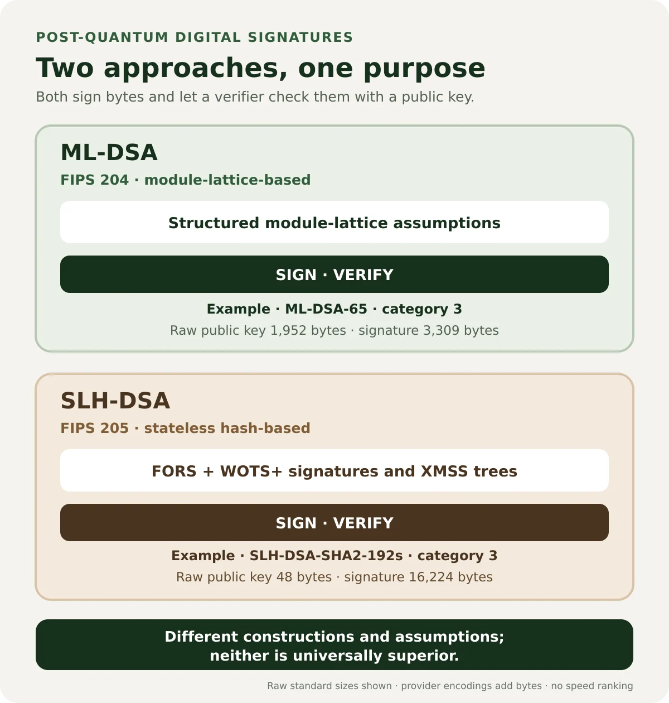

In [Part 4](/posts/mldsa-post-quantum-digital-signatures/), we looked at ML-DSA, NIST's module-lattice-based signature standard. It gives applications a post-quantum way to sign data and verify it. A natural follow-up is: if ML-DSA already does that, why did NIST also standardize SLH-DSA?

The short answer is cryptographic diversity. SLH-DSA is built from hash-based constructions rather than module lattices, so its security rests on a different family of assumptions. It also makes different tradeoffs: its public keys are compact, while its signatures are comparatively large. Those differences can matter when choosing a standard for long-lived software, firmware, or trust infrastructure.

This article is a software engineer's guide to the design and its operational implications. It does not derive the construction or provide instructions for implementing a signature scheme. Use a maintained, conforming cryptographic provider and a protocol that explicitly supports the selected format.

## From ML-DSA to SLH-DSA

NIST published [FIPS 205](https://csrc.nist.gov/pubs/fips/205/final), the Stateless Hash-Based Digital Signature Standard, on August 13, 2024. The standard specifies SLH-DSA, a stateless hash-based signature family derived from the SPHINCS+ submission, with changes made during standardization. The standardized algorithm is called **SLH-DSA**; an implementation or format labeled SPHINCS+ is not automatically interchangeable with FIPS 205.

Both SLH-DSA and ML-DSA provide digital signatures: one key signs particular bytes, and a corresponding public key verifies the signature. Their constructions and assumptions differ. ML-DSA is module-lattice-based, as specified in [FIPS 204](https://csrc.nist.gov/pubs/fips/204/final). SLH-DSA is hash-based, as specified in FIPS 205. NIST's [PQC project](https://csrc.nist.gov/projects/post-quantum-cryptography) includes both among its finalized standards. In [Part 2, Inside ML-KEM](/posts/inside-ml-kem/), the series covered key encapsulation, a separate operation for establishing shared keying material rather than signing data.

This is one form of cryptographic diversity, not a ranking. A separate mathematical foundation can be useful in a long-term strategy, but it does not make one algorithm universally safer. Each still needs a trustworthy implementation, sound key handling, protocol support, and a deployment plan. [Part 1](/posts/post-quantum-cryptography-engineers/) explains the broader post-quantum migration motivation; [Part 3](/posts/crypto-agility-java-post-quantum-migration/) discusses how to make systems ready for algorithm changes.

## What hash-based signatures build on

A cryptographic hash function maps an input of arbitrary length to a fixed-size output. A signature construction can use hash functions as components, but hashing a message alone does not sign it: anyone can compute a hash. A signature still requires secret key material and a verification procedure that relates the signature to a public key.

FIPS 205 uses specified hash and pseudorandom-function constructions in a larger design. Relevant security properties include the difficulty of finding an input for a given hash output (preimage resistance), finding another input with the same output as a chosen input (second-preimage resistance), and finding any two distinct inputs with the same output (collision resistance). Which property matters depends on the construction and use. It is too simplistic to say that the whole standard depends on only one of these properties.

The standard also separates uses of hash functions with addresses and domain-separation inputs. Conceptually, the same primitive is given context so that a hash used for one tree, key, or function role is not silently treated as though it belonged to another role. FIPS 205 specifies the exact encodings, functions, and parameter relationships. This contextualization is one reason a general-purpose hash API is not a substitute for a conforming SLH-DSA implementation.

The standard offers SHA-2 and SHAKE parameter families. They are distinct standardized choices within SLH-DSA; the family label is part of the parameter-set identity. A protocol must identify the algorithm precisely so both sides agree on the same standardized scheme and encoding.

## One-time signatures and why trees help

A useful way to understand hash-based signatures is to start with a one-time signature (OTS). In an educational Lamport construction, a private key contains a random secret for each possible message-bit value. The corresponding public key contains hashes of those secrets. To sign a bit, the signer reveals the secret associated with that bit; a verifier hashes the revealed value and compares it with the matching public value.

That illustration has a critical limitation: revealing values for one message can expose information that makes signing another message unsafe. A Lamport key is intended for one use. Winternitz-style schemes reduce the size and work by using chains of hash applications, and WOTS+ is the one-time signature construction used in the FIPS 205 design. Its details include carefully specified chains and parameters; the Lamport sketch is only an intuition, not the standardized algorithm.

One-time keys are awkward if the application needs many signatures. A Merkle tree provides a way to commit to many OTS public keys using one root. Put four public-key hashes at the leaves, `L0` through `L3`. Hash pairs to make parents:

```text
P0 = H(L0 || L1)       P1 = H(L2 || L3)
root = H(P0 || P1)
```

To authenticate `L2`, a verifier needs `L3` as its sibling and `P0` as the sibling of their parent. The verifier recomputes `P1 = H(L2 || L3)`, then the root, and checks that it matches the trusted root. These sibling hashes form an authentication path. The proof grows with the tree height rather than requiring the signer to send every other public key.

This is a cryptographic commitment structure, not a blockchain or consensus mechanism. A trusted root can authenticate many leaves, while the signature includes the path needed to connect the relevant leaf to that root. Those paths contribute to signature size.

## How FIPS 205 assembles SLH-DSA

SLH-DSA combines a few-time signature layer with tree authentication. The main components named by FIPS 205 are FORS, WOTS+, XMSS, and a hypertree. Each has a distinct role:

- **FORS** (Forest of Random Subsets) is a few-time signature scheme. It signs a digest derived from the message and signature-specific randomness.
- **WOTS+** (Winternitz One-Time Signature Plus) is a one-time signature scheme built from hash chains. In this construction it signs tree-node values, including roots that must be authenticated at higher levels.
- **XMSS** (eXtended Merkle Signature Scheme) combines WOTS+ with a Merkle tree and an authentication path. It is a multi-time tree signature construction.
- **The hypertree** stacks multiple XMSS layers. Each layer authenticates the root from the layer below, ultimately linking the signature to the public root in the public key.

At a high level, the signer processes the message and prescribed randomization to obtain a digest that selects the FORS material. FORS signs that digest. The signature then carries the information needed to authenticate the FORS public key through XMSS layers in the hypertree. A verifier processes the same message, reconstructs the relevant values and authentication paths, and checks whether they lead to the public root.

That is an orientation, not a signing recipe. The standard defines parameterized functions, address handling, message processing, key generation, and exact serialization in detail. Its WOTS+ and XMSS components also are not identical to the schemes defined by [RFC 8391](https://www.rfc-editor.org/rfc/rfc8391.html) or [NIST SP 800-208](https://csrc.nist.gov/pubs/sp/800/208/final). Do not combine pieces from different specifications or build a custom variant.

FIPS 205 specifies a randomized signing procedure and a deterministic variant. Applications should use the provider's standards-conforming signing API and documented randomness behavior. Do not supply ad hoc randomness, replace the message processing, or manually manage internal one-time keys.

## What “stateless” means

Stateful hash-based signature families such as XMSS and LMS track which one-time key index has been used. Reusing an OTS key can undermine security. The index must be persisted and advanced correctly across parallel signing, crashes, backups, and restores. Restoring a stale snapshot can accidentally reuse a key that was already used after the backup.

SLH-DSA is **stateless** in the sense that an application does not have to persist and coordinate a mutable per-signature leaf index as part of signing. Its randomized construction permits signatures without consuming a sequential one-time-key state in application storage. That removes an operational hazard that stateful schemes must address.

Stateless does not mean there are no private keys, no randomness, no key lifecycle, no provider state, or no application data to protect. Key generation and signing still have prescribed cryptographic requirements. The signing key must remain secret, the implementation must follow FIPS 205, and the application still needs rotation, backup, access control, and recovery policies. NIST SP 800-208 covers approved stateful hash-based schemes; it is helpful background for understanding why state management is a separate engineering concern.

## SLH-DSA parameter sets

FIPS 205 defines twelve parameter sets: SHA2 and SHAKE variants at three security strengths, with an `s` or `f` suffix. The `s` sets are designed for smaller signatures; the `f` sets are designed for faster signing. These labels describe standard tradeoffs, not a benchmark guarantee for your Java provider or hardware.

The number in the name maps to the standard's `n` choice: 128, 192, or 256 bits. Corresponding NIST security categories are 1, 3, and 5. These categories are comparison levels, not an exact claim that an implementation has that many bits of security against every attack. SHA2 and SHAKE versions at the same strength/suffix have the same key and signature lengths. The twelve names are `SLH-DSA-SHA2-128s`, `SLH-DSA-SHA2-128f`, `SLH-DSA-SHA2-192s`, `SLH-DSA-SHA2-192f`, `SLH-DSA-SHA2-256s`, `SLH-DSA-SHA2-256f`, and the corresponding six `SLH-DSA-SHAKE-*` sets.

| Parameter sets (SHA2 and SHAKE) | NIST category | Raw public key | Raw private key |    Signature | Design emphasis   |
| ------------------------------- | ------------: | -------------: | --------------: | -----------: | ----------------- |
| `SLH-DSA-*-128s`                |             1 |       32 bytes |        64 bytes |  7,856 bytes | Smaller signature |
| `SLH-DSA-*-128f`                |             1 |       32 bytes |        64 bytes | 17,088 bytes | Faster signing    |
| `SLH-DSA-*-192s`                |             3 |       48 bytes |        96 bytes | 16,224 bytes | Smaller signature |
| `SLH-DSA-*-192f`                |             3 |       48 bytes |        96 bytes | 35,664 bytes | Faster signing    |
| `SLH-DSA-*-256s`                |             5 |       64 bytes |       128 bytes | 29,792 bytes | Smaller signature |
| `SLH-DSA-*-256f`                |             5 |       64 bytes |       128 bytes | 49,856 bytes | Faster signing    |

Here `*` stands for either `SHA2` or `SHAKE`, so for example the first row covers `SLH-DSA-SHA2-128s` and `SLH-DSA-SHAKE-128s`. The raw public and private sizes follow the FIPS 205 key components (`2n` and `4n` bytes). These are standardized key byte strings, not necessarily the length returned by a provider's encoded-key API. ASN.1/PKCS#8 wrappers, certificates, JSON formats, and complete signed envelopes add their own structure and bytes.

A signature of 7,856 to 49,856 bytes has different consequences from a signature that is a few hundred bytes. Check API gateways, message-size caps, firmware partitions, database columns, signed package metadata, certificate and transport limits, and storage budgets. Also test complete encodings: a raw FIPS signature size is not the size of a base64 string or an enclosing object. NIST's [SP 800-230 initial public draft](https://csrc.nist.gov/pubs/sp/800/230/ipd), available as a draft as of this article's publication, discusses additional parameter-set proposals. Those proposals are not additional final FIPS 205 parameter sets; use FIPS 205 when claiming standardized SLH-DSA support.

Parameter selection should begin with the protocol's required security category and the system's size constraints, not with an assumption that the biggest suffix is best. The `s` and `f` suffixes offer different standard profiles, but do not promise a universal latency result. Measure key generation, signing, and verification separately using the provider and Java runtime you will deploy. A firmware publisher that signs infrequently but ships manifests over a constrained link may value a smaller signature differently from a high-volume service that signs many artifacts. Verification may be performed by far more clients than signing, so measure both sides.

The standard's parameter table also has operational meaning for formats. Decide whether your protocol transports raw FIPS key bytes or a provider's encoded key, and make that encoding explicit. A 32-byte raw public key can still appear inside a longer certificate or object with algorithm identifiers and metadata. Similarly, the signature's binary size is only one factor in a base64, ASN.1, JSON, or package representation. Use real protocol fixtures when checking size limits rather than estimating from primitive sizes alone.

## SLH-DSA and ML-DSA compared

The two standards solve the same broad application problem—creating and verifying digital signatures—but their constructions and operational profiles differ.

| Consideration            | ML-DSA (FIPS 204)                                                                                             | SLH-DSA (FIPS 205)                                                                                                        |
| ------------------------ | ------------------------------------------------------------------------------------------------------------- | ------------------------------------------------------------------------------------------------------------------------- |
| Construction             | Module-lattice-based                                                                                          | Stateless hash-based; FORS and hypertree of XMSS/WOTS+                                                                    |
| Security basis           | Structured module-lattice assumptions                                                                         | FIPS-specified hash and pseudorandom-function assumptions                                                                 |
| Parameter categories     | 2, 3, 5                                                                                                       | 1, 3, 5                                                                                                                   |
| Representative raw sizes | ML-DSA-65: 1,952-byte public key, 4,032-byte expanded private key, 3,309-byte signature                       | SLH-DSA-SHA2-192s: 48-byte public key, 96-byte private key, 16,224-byte signature                                         |
| Engineering tradeoff     | More compact signatures for the standardized sets shown; implementation costs depend on provider and workload | Very compact raw public keys, substantially larger signatures; `s`/`f` sets trade signature size against signing emphasis |

The representative examples both correspond to NIST security category 3, but they use different cryptographic constructions and security assumptions. The table illustrates key and signature size differences, not equivalent performance or a guarantee of identical security properties. Neither family is universally faster or safer. Runtime, provider, hardware, message size, signing frequency, verification volume, and protocol encoding all matter. Benchmark and interoperability-test the exact combination under consideration.

<figure class="article-figure">



  <figcaption>Both provide signatures, but neither is universally superior: ML-DSA and SLH-DSA use different constructions, assumptions, and size profiles. This comparison makes no provider-specific speed claim.</figcaption>

</figure>

## Java integration: select a provider deliberately

Java's JCA offers interfaces such as `KeyPairGenerator` and `Signature`, while installed providers supply algorithm implementations. The API being present does not guarantee that every runtime includes every algorithm. Oracle's JDK 26 provider documentation lists ML-DSA services in SUN, but does not list SLH-DSA there. Provider availability varies by JDK distribution and release.

The following example uses the JCA provider interface with the official Bouncy Castle Java provider, version 1.86, and `SLH-DSA-SHA2-128s`. It was compiled and run locally on OpenJDK 21.0.12.1. The dependency is `org.bouncycastle:bcprov-jdk18on:1.86`. The parameter spec and service names are Bouncy Castle's provider-specific offerings; verify their support and encodings for the precise provider version you deploy.

```java
import java.nio.charset.StandardCharsets;
import java.security.KeyPair;
import java.security.KeyPairGenerator;
import java.security.Provider;
import java.security.SecureRandom;
import java.security.Security;
import java.security.Signature;

import org.bouncycastle.jcajce.spec.SLHDSAParameterSpec;
import org.bouncycastle.jce.provider.BouncyCastleProvider;

public class SlhDsaExample {
    public static void main(String[] args) throws Exception {
        Provider bc = new BouncyCastleProvider();
        Security.addProvider(bc);

        KeyPairGenerator generator = KeyPairGenerator.getInstance("SLH-DSA", "BC");
        generator.initialize(SLHDSAParameterSpec.slh_dsa_sha2_128s, new SecureRandom());
        KeyPair signingKeys = generator.generateKeyPair();
        KeyPair unrelatedKeys = generator.generateKeyPair();

        byte[] message = "release: 5.0.0".getBytes(StandardCharsets.UTF_8);
        Signature signer = Signature.getInstance("SLH-DSA", "BC");
        signer.initSign(signingKeys.getPrivate(), new SecureRandom());
        signer.update(message);
        byte[] signature = signer.sign();

        Signature verifier = Signature.getInstance("SLH-DSA", "BC");
        verifier.initVerify(signingKeys.getPublic());
        verifier.update(message);
        if (!verifier.verify(signature)) {
            throw new SecurityException("Signature did not verify");
        }

        byte[] modified = message.clone();
        modified[0] ^= 1;
        verifier.initVerify(signingKeys.getPublic());
        verifier.update(modified);
        if (verifier.verify(signature)) {
            throw new SecurityException("Modified message was accepted");
        }

        verifier.initVerify(unrelatedKeys.getPublic());
        verifier.update(message);
        if (verifier.verify(signature)) {
            throw new SecurityException("Unrelated public key was accepted");
        }

        System.out.printf("Accepted valid signature; rejected tampering and wrong key (%d bytes).%n",
                signature.length);
    }
}
```

This is an API example, not a message protocol. The code signs the exact UTF-8 bytes and keeps both key pairs in memory. Do not log or serialize a private key casually. For structured content, define a canonical byte representation and a protocol algorithm identifier; otherwise, semantically equivalent JSON can produce different signed bytes. A verifier must select only supported, allowed algorithms and reject unknown or disallowed identifiers rather than silently falling back.

Provider key encodings and import/export support are not interchangeable merely because two providers expose JCA interfaces. Confirm `getEncoded()` formats, key-factory support, certificate integration, and interoperability for the specific provider and format. Oracle JDK 26's documented SUN provider does not provide SLH-DSA; Bouncy Castle 1.86 does provide the services used above. This does not imply that every KMS, HSM, certificate authority, JOSE library, or managed runtime supports it. Verify support at each boundary before choosing SLH-DSA for a production protocol.

Before adopting a provider, check its exact release notes and algorithm documentation, then run interoperability tests with the key formats and peer implementations in your deployment. A JCA service name only tells you how to ask that provider for an operation; it does not settle whether another provider accepts the resulting key encoding or whether a protocol assigns the same meaning to it. Pinning a provider in a small example makes the implementation reproducible. Production deployments should use their approved provider configuration and verify that upgrade policy does not silently change algorithms or encodings.

For a migration, introduce explicit algorithm identifiers at the boundary that owns the signature format. Keep verification of existing signatures available for as long as the associated artifacts need to be validated, while controlling which algorithm may be used for new signatures. Measure any continued legacy verification and remove it only when clients, archives, and operational workflows no longer depend on it. This follows the broader crypto-agility approach from Part 3 without turning every business service into an algorithm selector.

## Deployment, trust, and verification

SLH-DSA can be considered for release signing, firmware or update manifests, long-lived signed artifacts, and other cases where compact public keys and an alternative signature assumption are useful. These are potential fits, not claims that a particular ecosystem or product already interoperates with the standard. The larger signature may be a practical obstacle for constrained links, certificates, or formats with strict size limits.

A signature only establishes a cryptographic relationship between bytes and a key. The application still needs a trusted public-key distribution and identity binding, key identifiers, rotation and revocation policy, and a response to verification failure. A mathematically valid signature does not prove a real-world person signed it. A captured valid signature can also be replayed unless the signed message or surrounding protocol includes freshness and uniqueness controls.

Treat the signed bytes as a protocol contract. If the signature covers an artifact, make sure the verifier receives exactly the bytes that were signed. For structured data, use a defined canonicalization or sign a precisely specified binary representation. Include an explicit algorithm and format identifier where the enclosing protocol requires it, bind relevant context such as version or artifact purpose, and authenticate that context according to the protocol. Avoid designing a custom envelope or signature combiner without a vetted specification and review.

Plan for signature overhead across the full path: database and object-store fields, API payload limits, proxies, queues, firmware, certificates, client SDKs, and archival systems. For long-term verification, preserve the signed bytes, signature, public key or trusted certificate chain, algorithm identifiers, and the validation context needed by future verifiers. Keep these records under an explicit retention and key-compromise policy.

Finally, check signing infrastructure early. A Java provider may support an algorithm while an HSM, KMS, certificate profile, signing service, or build platform does not. Verify key generation, non-exportable key use, backup and recovery, audit logging, throughput under your workload, and cross-provider verification before committing to a migration. Cryptographic support in one library is only one part of operational interoperability.

A useful acceptance suite has independent fixtures, not only a test that signs and immediately verifies with the same implementation. Check provider-generated signatures against the same provider after process restart, and—where interoperability is required—verify with a second implementation that claims FIPS 205 support. Include altered-message and wrong-key rejection, malformed or truncated signatures, unsupported algorithm identifiers, unavailable-provider behavior, and serialization round trips. For standardized primitives, use official test vectors or provider conformance material where available; do not create expected cryptographic outputs by hand.

A signature's validity also depends on context. The verifier should know what object type was signed, which protocol version applies, and which key identifier and algorithm are allowed. A valid signature for a release manifest should not accidentally be accepted as authorization for a different message type. Bind purpose and version using the protocol's defined signed representation, and include freshness data when replay matters. These controls belong to the application protocol around the primitive, not to SLH-DSA's mathematical signature check itself.

When storing signed artifacts for years, retain enough information to interpret them later: exact signed bytes, signature bytes, algorithm and format identifiers, the public key or trust-chain evidence, and relevant validation records. Avoid assuming a future verifier can infer the original encoding from a filename or current provider defaults. Long-term verification is a data-retention and trust-policy problem as well as a signature-algorithm choice.

## Common mistakes to avoid

- **Treating a hash as a signature.** Hashing is public computation; signing uses protected key material and a verification algorithm.
- **Reusing one-time-key concepts by hand.** FORS, WOTS+, XMSS, and their parameters are handled within the standardized SLH-DSA construction. Do not expose their internals as an application-level key-management task.
- **Assuming SPHINCS+ means FIPS 205.** SLH-DSA derives from SPHINCS+, but standardization made changes. Check actual conformance and encoding compatibility.
- **Assuming “stateless” means operationally state-free.** Key custody, randomness, provider behavior, rotation, recovery, and monitoring still need engineering controls.
- **Comparing only the signature primitive.** Formats, certificates, transport limits, trusted-key distribution, and provider support can determine whether the system interoperates.
- **Failing open.** An invalid signature, unknown algorithm, unsupported parameter set, or unavailable provider must not result in accepting unauthenticated content or an unreviewed downgrade.

SLH-DSA is not a drop-in replacement for every signature format. Treat algorithm migration as both a cryptographic choice and a compatibility project, as [Part 3](/posts/crypto-agility-java-post-quantum-migration/) describes. The right decision comes from your threat model, data lifetime, required security category, ecosystem support, and measured workload—not from choosing whichever name sounds most conservative.

## References

- [NIST FIPS 205: Stateless Hash-Based Digital Signature Standard](https://csrc.nist.gov/pubs/fips/205/final)
- [NIST FIPS 204: Module-Lattice-Based Digital Signature Standard](https://csrc.nist.gov/pubs/fips/204/final)
- [NIST Post-Quantum Cryptography project](https://csrc.nist.gov/projects/post-quantum-cryptography)
- [NIST SP 800-208: Recommendation for Stateful Hash-Based Signature Schemes](https://csrc.nist.gov/pubs/sp/800/208/final)
- [NIST SP 800-230 initial public draft](https://csrc.nist.gov/pubs/sp/800/230/ipd) — draft, not a final standard
- [SPHINCS+ round 3.1 specification](https://sphincs.org/data/sphincs%2B-r3.1-specification.pdf) — original submission background, not the FIPS 205 definition
- [The SPHINCS+ Signature Framework](https://sphincs.org/data/sphincs%2B-paper.pdf) — research background for the standardized design's predecessor
- [Bouncy Castle Java 1.86 release notes](https://www.bouncycastle.org/resources/new-release-bouncy-castle-java-1-86/)
- [Bouncy Castle `SLHDSAParameterSpec` API documentation](https://downloads.bouncycastle.org/java/docs/bcprov-jdk18on-javadoc/org/bouncycastle/jcajce/spec/SLHDSAParameterSpec.html)
- [Oracle JDK 26 provider documentation](https://docs.oracle.com/en/java/javase/26/security/oracle-providers.html)
